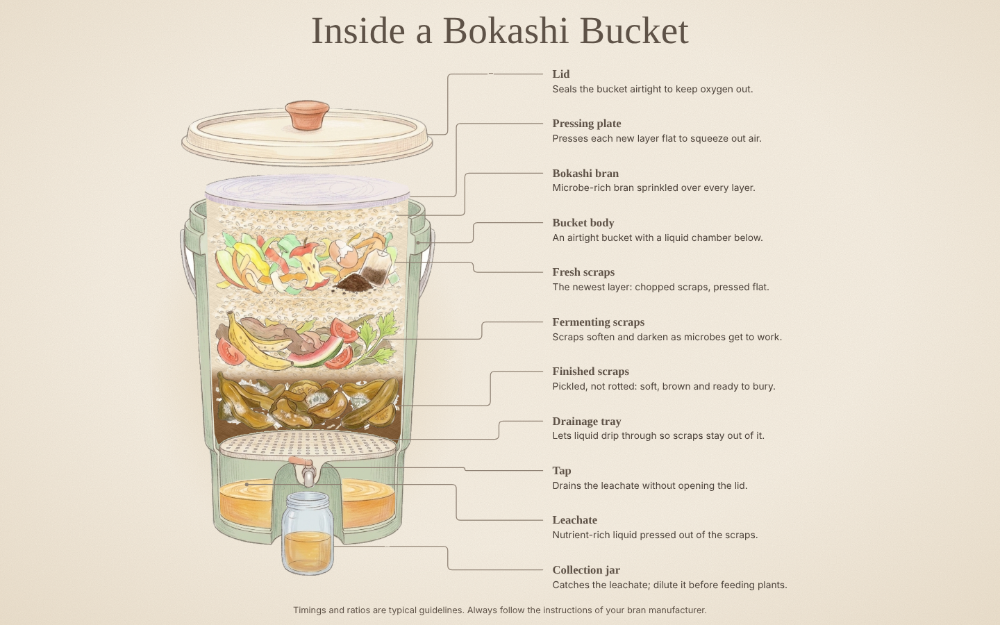

# Inside a Bokashi Bucket

**An interactive, hand-drawn guide to Bokashi composting for complete beginners.**

Final project for **ESPM 98 DeCal: Intro to Compost and Vermiculture** at UC Berkeley (Fall 2026).
Assignment: *Communicating Compost & Understanding Food Waste*.



---

## What is this?

Bokashi is a way to ferment kitchen scraps (including small amounts of meat, dairy and cooked food) in a sealed bucket before they go into the soil. The process is simple, but it can feel intimidating at first because so much happens out of sight inside the bucket.

This page opens the bucket up. It shows a cutaway illustration of a Bokashi bucket, layer by layer, and explains what each part is, what it should look like and what to watch out for:

| Part | What you learn |
|---|---|
| Lid and pressing plate | Why keeping air out is the whole point |
| Bokashi bran | The microbes that start fermentation |
| Fresh, fermenting and finished scraps | How food scraps change over about two weeks |
| Drainage tray, leachate, tap and jar | Where the liquid goes and how to use it |

## How to use it

- **Hover** over any part of the bucket, or its card, to highlight it.
- **Click** a part or card to open a short explainer for it.
- Press **Back**, **Esc** or your browser's back button to return to the overview.
- Every part has its own link. For example, `#leachate` opens the leachate explainer directly.

The page works on desktop and mobile, and with keyboard only: Tab moves through the cards, and Enter opens one.

## View it online (GitHub Pages)

1. Upload the contents of this folder to a new GitHub repository. `index.html` should be at the top level of the repository.
2. In the repository, go to **Settings → Pages**.
3. Under **Build and deployment**, choose **Deploy from a branch**. Select the `main` branch and the `/ (root)` folder, then click **Save**.
4. After a minute or two, the page is live at `https://<your-username>.github.io/<repository-name>/`.

All paths are relative, so the site works at that address without any changes.

## Run it locally

You need Python 3, or any other static file server. From this folder, run:

```bash
python3 -m http.server 8000
```

Then open <http://localhost:8000>.

Opening `index.html` directly from your file system also works. Hover detection is slightly less precise that way, because browsers don't allow pixel-level image reads from local files.

## Project structure

```
index.html        page structure (contains no text content)
css/style.css     styling: colored-pencil palette, layout, glow effects
js/content.js     ALL text on the page (edit this file to change the copy)
js/app.js         illustration layout, hover/click logic, connector lines, routing
assets/           illustration layers (transparent PNGs)
docs/             screenshot used in this README
```

## Editing the text

Every word on the page lives in [`js/content.js`](js/content.js), so you never need to touch the HTML or other code. Each part of the bucket has one entry:

```js
{
  id: "leachate",               // which part of the bucket this is (don't change)
  title: "Leachate",
  short: "Nutrient-rich liquid pressed out of the scraps.",   // one sentence, about 60 characters
  what:  "What it is ...",
  state: "What it should look like ...",
  tips:  ["Tip one", "Tip two"],

  // optional:
  extra: [{ heading: "More", paragraphs: ["..."], bullets: ["..."] }],
  note:  "A small footnote at the bottom."
}
```

Longer text is fine: card text wraps instead of being cut off, and the explainer panel scrolls.

## How it was made

- **Illustrations:** generated with Google's Nano Banana image model in a soft colored-pencil style, then cut out, cleaned up and layered so each part of the bucket can be highlighted on its own.
- **Code:** plain HTML, CSS and JavaScript, with no frameworks and no build step. Hover detection reads each layer's transparency, so only the visible part of an illustration responds to the mouse.
- **Fonts:** [Fraunces](https://fonts.google.com/specimen/Fraunces) and [Nunito](https://fonts.google.com/specimen/Nunito) from Google Fonts.

## A note on accuracy

The timings, amounts and ratios on this page are typical beginner guidelines, not strict rules. Bokashi bran products differ, so always follow the instructions that come with yours.

---

*Made for ESPM 98 DeCal: Intro to Compost and Vermiculture, UC Berkeley.*
